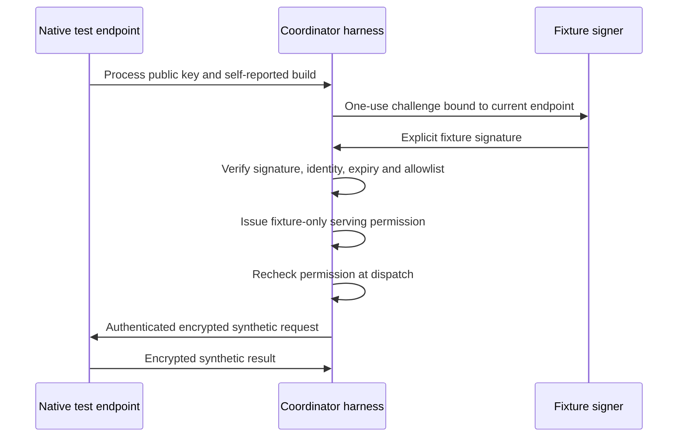

# Provider attestation feasibility: first checkpoint

## Decision

The isolated authorization and encrypted-endpoint protocol is feasible.
Native Apple App Attest authorization is **not yet qualified**. Do not enable
verified/private routing or describe this experiment as confidential inference.
Keep it outside the release's serving, Desktop, billing and relay paths.

The prototype and reproduction commands are in
[`experiments/provider_attestation`](../../../experiments/provider_attestation/README.md).
No inference model, weights or production credential is required.

## Measured environment and results

Checked 2026-10-15 from main `672160302657868751ca024e2331852be90bb780`:

- Apple Silicon Studio, macOS 26.5.2 (25F84), Xcode 26.6 (17F113).
- Python 3.12.14, cryptography 48.0.1, pytest 9.0.2 in a scratch venv.
- The current session reports no valid code-signing identities. The probe was
  compiled locally and signed ad hoc with Hardened Runtime and no entitlement
  exceptions. Bundle signature verification passed.
- A real Secure Enclave ephemeral P-256 sign/verify operation succeeded.
  This establishes local hardware-key usability, **not remote attestation**.
- `DCAppAttestService.shared.isSupported` returned false. The native `attest`
  command refused with `app_attest_unsupported`. The binary has neither an
  official Developer ID identity nor App Attest provisioning. This observation
  must not be generalized to every OS version or to a properly provisioned
  release artifact. No Apple key generation was attempted on the unsupported
  path.
- Real X25519 / HKDF-SHA256 / AES-GCM interoperation passed between Python and
  a separate Swift process. Only that process held its private transport key.
  It decrypted a synthetic input and returned an encrypted digest result.
  The coordinator could verify the result; no MLX inference occurred.
- 28 focused tests passed, including native-process checks. Covered forged
  proofs, consumed/replayed/expired challenges, account/model/key/connection
  substitution, expired permissions, build revocation, disconnect/reconnect,
  null keys, payload bounds, ciphertext and response tampering/replay,
  rejection by a different native process, and altered-bundle signature failure.
- Python Ruff lint/format and native Swift formatting are checked separately.

## Trust boundary exercised

The fixture signer is deliberately controlled by the test harness. It does not
prove that a Mac, binary, runtime or operating system is trustworthy. The
coordinator's default Apple mode always denies authorization until a complete
Apple verifier is independently qualified. A successful fixture run cannot
change that policy, and unsupported Apple APIs never trigger a fallback.

The native IPC channel is a trusted local test channel, not an authenticated
network endpoint. It does not itself enforce server permissions against its
owner. The coordinator is a sequential model of an already authenticated
gateway, not an Internet API; account context and approved build hashes are
test inputs. These constraints prevent this prototype from being used to claim
production protection based on a self-report or a locally generated signature.

## What must be proven next

1. **Actual Apple qualification.** Use a supported Mac/OS and an exact signed,
   entitled, provisioned artifact. Complete real evidence generation and server
   validation of the Apple chain, application identity, nonce, macOS key access
   policy and assertion counters. An API availability flag or signature alone
   is insufficient. Preserve strict failure on unavailable/unqualified proof.
2. **A closed plaintext runtime.** Today the product runs Python/TensorFold/MLX
   in another process and permits runtime flexibility for those libraries.
   Attesting only the GUI does not bind that mutable execution chain. Determine
   whether a closed Python runtime can be qualified or a native provider is
   required. The synthetic native transform does not answer this question.
3. **Actual protected inference.** Only after the first two gates, run a model
   with plaintext confined to the qualified process and test modified imports,
   injected libraries, debugger attachment, security-state transitions, reboot,
   update, revocation and failure during request handoff. Keep performance and
   computation-integrity claims separate from app identity.

Vector owns the endpoint/verifier experiment, Pixel owns any eventual native
integration, Harbor owns exact signed-artifact qualification, and Atlas owns
the decision to introduce a verified routing tier. No production rollout or
release is authorized by this result. Rollback for this checkpoint is removing
the experiment; no existing user setting, service, route or schema changes.

## Primary references

- [Apple: establishing app integrity](https://developer.apple.com/documentation/devicecheck/establishing-your-app-s-integrity)
- [Apple: validating apps on the server](https://developer.apple.com/documentation/devicecheck/validating-apps-that-connect-to-your-server)
- [Apple: runtime availability](https://developer.apple.com/documentation/devicecheck/dcappattestservice/issupported)
- [Apple: Hardened Runtime](https://developer.apple.com/documentation/security/hardened-runtime)

Availability text and macOS-specific verification guidance differ across the
published documentation and SDK snapshots consulted. A real supported-device,
signed-artifact test remains authoritative for qualification; do not infer
support from the existence of a header or a third-party implementation.
